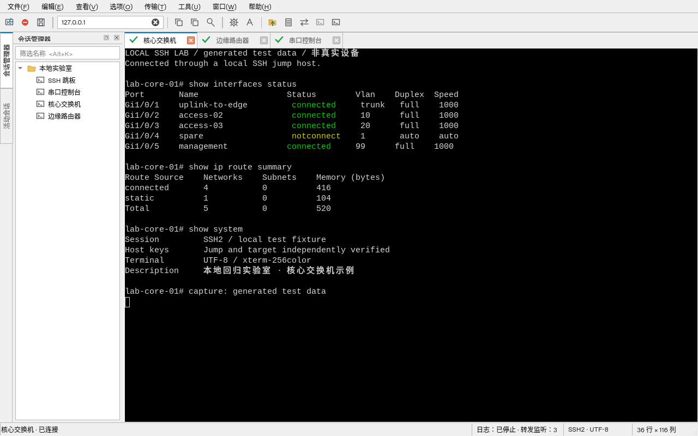

# Harbor Terminal 0.6.0

面向 Windows 10/11 的独立 SSH / 串口桌面客户端。0.6补充会话管理、CSV/TSV导入、批量编辑、协议默认模板、克隆/重连入口及配置并发保护，保留参照SecureCRT 9.7设计的紧凑界面。已有原生Windows x64 EXE和实际测试，尚未达到SecureCRT 9.7.4全功能等价。

[0.6交付记录](docs/releases/0.6.md) · [会话管理说明](docs/session-management.md) · [验证证据](artifacts/validation-0.6.md) · [实体COM测试](docs/windows-hardware-testing.md) · [SecureCRT同机对照](docs/windows-comparison.md)

## 0.6会话与配置工作流

- “文件 → 会话管理…”（Alt+Shift+S）支持多选、批量编辑与字段预览，只有勾选字段会改动；取消不写入。
- CSV/TSV列映射和行选择，UTF-8/GB18030/UTF-16，新增/替换/合并/复制四种策略；Harbor原生XML/JSON可选范围导入导出。
- 会话/文件夹路径重命名同步更新跳板引用；删除被引用跳板时需明确处理依赖。
- “选项 → 默认会话模板…”分别保存SSH/Serial初始参数，已有会话保持原值；批量套用需选范围/字段。
- OS文件锁、修订冲突检查与上次有效备份；损坏原文件不覆盖，恢复先预览并保留damaged副本。
- 当前连接可克隆、手动重连与临时改标签名；重新认证、各连接独立。活动列表支持筛选、计数、批量断开/输入锁。
- 输入锁仅防误触，保留输出/复制及已启动流程，自动协议应答独立运行；没有口令安全锁。

[会话管理](artifacts/harbor-0.6.0-session-manager.png) · [导入映射](artifacts/harbor-0.6.0-session-import.png) · [批量预览](artifacts/harbor-0.6.0-session-preview.png) · [默认模板](artifacts/harbor-0.6.0-defaults.png)

## 0.5认证与命令基础

- 多轮多提示MFA按echo位显示/掩码，保留LF，跳板/目标分别应答；取消、过期或重复回复不会继续。五种认证顺序预设不保存答案。
- `Alt+M`打开多行命令、最近50条内存历史、命令库与按钮栏。勾选目标后预览，目标在预览时固定；分别列入队结果，不自动重试。按钮只指向当前交互会话。
- JSON流程支持send、字面wait、delay，跨分片增量匹配，最多64步/600秒/64KiB捕获；取消清理未发送数据，已发送内容不能撤回。流程期间Ctrl+C取消并发送中断。
- 命令库、导出流程与捕获报告是本机明文，请勿写入密码/令牌。不执行Python/eval或提供crt对象。匹配提示不表示设备命令执行成功。
- GUI支持`admin@host:2222`、`[IPv6]:port`和SSH URI预填；不自动发送，不接受URI/命令行口令。
- `--run-flow flow.json --output new-result.json`无界面执行SSH密钥/默认Agent或Serial流程；CLI未实现交互MFA/私钥口令输入。仅通道SSH不打开Shell，可用SFTP/隧道。

183项能力中仍有85项未实现，33项已测子集和60项部分实现也不表示完整模块已完成。实际Windows 10/11、实体COM与长期对照按真实报告验收。

完整规格见 [历代累积功能审计](docs/research/README.md)：32 个系列、314 个发布分节、4294 条历史 bullet、183 项能力/验收。每项实现与缺口记录在 [功能矩阵](docs/research/feature-matrix.md)，本次界面变更见 [0.4.1 记录](docs/releases/0.4.1.md)，连接能力见 [0.4](docs/releases/0.4.md) 及 [0.3](docs/releases/0.3.md)。参考公开界面布局，未包含 SecureCRT 代码或品牌素材，工具栏图标独立绘制。



## 界面与字体

- 顶部菜单与16px图标工具栏，左侧会话管理器/活动会话，窄标签、底部状态栏；快速连接参数在独立弹窗中。
- `Alt+Q`快速连接，`Alt+R`聚焦顶部主机输入，`Alt+K`筛选会话。双击保存会话会载入参数并打开连接弹窗。
- Windows界面优先Segoe UI 9pt，终端优先Consolas 11pt；没有该字体时选Cascadia Mono或其他已安装等宽字体。云端截图使用Noto Sans CJK SC / Liberation Mono，不分发Windows字体。
- “选项 → 终端字体”选择全局等宽字体与字号，更新所有标签并同步SSH行列；Ctrl+滚轮只临时缩放当前标签。字格保留字体的实际宽度，减少额外行距。
- “查看 → 界面主题”切换经典浅色/深色；“选项 → 终端配色”选择黑底、浅色或深蓝。显示偏好独立保存在会话文件旁的`appearance.ini`，不保存连接凭据。
- `Ctrl+F`打开可关闭的查找栏；`Ctrl+C/D/S`仍发送终端控制字符，保存会话使用`Alt+S`。

[深色界面](artifacts/harbor-0.6.0-terminal-dark.png) · [快速连接](artifacts/harbor-0.6.0-quick-connect.png) · [会话选项](artifacts/harbor-0.6.0-options.png)

## 本次可用的工作流

- 单级SSH跳板：引用已保存的SSH会话，跳板与目标独立认证及主机密钥校验，取消/失败关闭两端；不做自动信任。
- SSH隧道窗口：本地转发、远程转发、本地SOCKS代理，列出与停止监听；每会话最多16个，监听请求固定127.0.0.1。
- SFTP目录浏览与单文件上传下载、SHA-256回读、临时文件提交、显式覆盖、进度与取消；复用SSH认证。
- 会话日志：RX默认、TX可选，原始字节或文本分块JSONL，暂停/继续、大小分段与配额。
- 串口Hex/ASCII观察与原始字节发送；不追加换行、不自动重发。
- 多标签 SSH/串口，逐会话状态和错误；连接与关闭可取消，关闭窗口后自动完成清理。
- Qt 字格绘制 16/256/24位颜色、粗体/斜体/下划线/删除线/反色；中文宽字符、组合字符、增量解码。
- 窗口变化计算行列并更新 SSH PTY；备用屏幕、保存/恢复光标、常用 xterm 按键与应用光标/数字小键盘模式。
- Ctrl+C 发送中断字符；Ctrl+Shift+C/V 复制粘贴；多行粘贴可编辑确认，支持远端启用的 Bracketed Paste。
- Qt 输入法预编辑/提交接口，UTF-8、GB18030、Big5、Shift-JIS、Latin-1 可选；Windows 实际 IME 仍待验证。
- 当前终端字面文本查找/持续高亮、向前/向后跳转；Ctrl+F 聚焦查找，Ctrl+滚轮缩放。
- 层级会话树（名称可用 `文件夹/会话`）及按名称、主机、用户名过滤。
- 后台枚举串口/可手填设备；数据位、校验位、停止位、四种流控与波特率可保存；提供250ms BREAK入口。
- SSH 严格 known_hosts 校验，未知/变更密钥拒绝；密码与加密 OpenSSH 私钥认证已用真实本地 SSH 服务验证。默认密钥/Agent 由 AsyncSSH 提供，Windows Agent 尚未验证。

## Windows 运行

可从[成功的Windows构建](https://github.com/lhy8888/secureCRT/actions/workflows/validate.yml)下载HarborTerminal-Windows-unsigned，核对ZIP的SHA-256后完整解压；运行EXE无需另装Python。BUILD-INFO.json记录构建提交。原生CI使用Windows Server 2025，不能代替Windows 10/11实机。

开发安装Python 3.14.10，在PowerShell项目根目录执行：

```powershell
py -3.14 -m venv .venv
.\.venv\Scripts\python.exe -m pip install -r requirements-lock.txt
.\.venv\Scripts\python.exe -m pip install --no-deps .
.\.venv\Scripts\harbor-terminal.exe
```

按Alt+Q或点击工具栏快速连接图标，在弹窗填写SSH主机、端口、用户名和本次密码；私钥文件和本次口令在“会话选项 → SSH / 身份”中选择。连接前通过受信任渠道核实主机公钥指纹，再使用 OpenSSH 格式的 `known_hosts` 文件。非默认端口条目为 `[host]:port`。`ssh-keyscan` 只能收集公钥，不能证明可信。没有忽略校验开关。

密码、私钥口令与私钥内容不写入会话配置或诊断日志；只允许保存私钥路径。Python 内存中的秘密副本不能保证擦除。配置v4可读取旧v1/v2/v3文件，读取旧文件时不自动改写；v4增加认证预设与仅通道模式，跳板仍只保存名称引用，不保存跳板密码。

使用跳板时，先保存一个独立SSH跳板会话，再加载目标会话，在“会话选项 → SSH / 跳板”中选择跳板并输入本次跳板密码/口令。目标密码在快速连接弹窗输入；两端各用自己的known_hosts。当前拒绝缺失引用和嵌套跳板。连接后的“传输 → SFTP文件”和“工具 → 会话日志 / SSH隧道”固定绑定打开它们的会话，切换标签不会转向其他连接。

隧道中，L的目标从SSH服务端访问，R的目标从本机访问，SOCKS的目标按代理请求从SSH服务端访问。监听端口0表示自动分配。关闭隧道窗口会保留监听；停止选中监听会拒绝新连接，已有数据流可能继续，断开SSH才会关闭全部流。远程服务器可能覆盖回环监听请求，应按其实际策略配置。SOCKS无代理认证，本机其他用户可能访问该监听；不提供公网监听入口。

快速连接中协议选Serial，设备栏填写`COM3`等或从枚举中选择，端口栏为波特率。“会话选项 → 串口”可改5–8位、N/E/O/M/S、1/1.5/2停止位、none/RTSCTS/DSRDTR/XONXOFF。波特率允许50–4,000,000，实际可用范围由设备和驱动决定；串口不提供SSH加密。云端不能访问你电脑上的实体COM。

## Windows 打包

```powershell
./scripts/build-windows.ps1
```

使用官方Windows Python3.14.10，生成`dist/HarborTerminal/HarborTerminal.exe`及完整运行库、ZIP/SHA-256、构建信息与依赖许可清单。已有远端Windows原生构建和实际冻结EXE测试；这是未签名开发包，无MSI/可信更新。必须完整解压保留整个目录。源码测试矩阵覆盖Windows/Linux与Python3.12/3.14。

包内运行`powershell -ExecutionPolicy Bypass -File .\Test-HarborHardware.ps1 -Mode Inventory`枚举真实设备。准备TX/RX回环后按[硬件说明](docs/windows-hardware-testing.md)做回环/拔插/72小时测试；报告只保存在本机Diagnostics，不自动上传。同机资源采样与步骤见[对照说明](docs/windows-comparison.md)。

## 验证与界面采集

```bash
cd /workspace/secureCRT
/workspace/securecrt-dev-venv/bin/python -m pytest -q
QT_QPA_PLATFORM=offscreen /workspace/securecrt-dev-venv/bin/python scripts/capture_terminal.py
QT_QPA_PLATFORM=offscreen /workspace/securecrt-dev-venv/bin/python scripts/capture_services.py
```

运行截图脚本前，修改源码后需重新执行 `python -m pip install --no-deps .`，脚本使用安装后的包。本地真实SSH服务验证加密收发、密钥拒绝、私钥认证、窗口变化、跳板、SFTP、三类转发及Qt输入链路；Linux PTY验证串口字节流。截图均来自生成测试数据，不是真实网络设备或Windows界面。

工具截图：[SFTP](artifacts/harbor-0.6.0-sftp.png) · [SSH隧道](artifacts/harbor-0.6.0-tunnels.png) · [会话日志](artifacts/harbor-0.6.0-log.png) · [串口Hex](artifacts/harbor-0.6.0-hex.png)。复查结果见 [本轮验证](artifacts/validation-0.6.md)。

## 实现边界

- SFTP当前限单文件，上传安全提交需hardlink/POSIX rename；不保留元数据，无递归/续传/独立SFTP登录。日志为JSONL分块，无逐行纯文本/跨日/自动脱敏。完整约束见0.3记录。
- 跳板仅单级，转发不保存模板、不自动重建；SOCKS5已测IPv4/域名、半关闭和取消，不支持代理认证；IPv6实际互通与长期并发待验收。仍无X/Y/Zmodem/Kermit、通用Python脚本对象、凭据库、快照/平铺、SecureCRT专有配置迁移和自动重连。
- 不是完整 VT320/TN3270/Wyse/Xterm 实现。未做 vim/tmux/top 全量回放、远端鼠标、闪烁、双高/双宽行、RTL/emoji完整字素兼容。OSC/DCS/APC/PM/SOS仍被过滤。
- 2000行历史；最多16个标签；网格最多512列×200行。缩小高度保留适用行与移出的历史，**横向缩小会裁切列，尚无软换行重排**。
- 接收256KiB、发送64KiB缓冲，收发独立并施加背压；CSI限制128字符，保存光标栈16项，每格32码点；每次解析有估算操作预算。这些边界不是操作系统级CPU/内存沙箱。
- 用户实体COM/热拔插、挂死驱动恢复、Windows 10/11 IME/多显示器/Agent、72小时稳定性与SecureCRT同机对照仍未验证；Windows Server原生CI与DPI启动子集已有证据。
