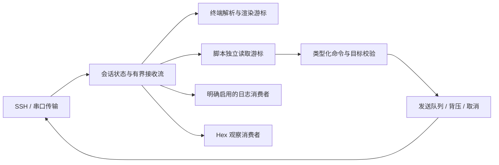

# 脚本能力需要行为契约，不只是运行 Python

来源：官方 [Scripting Essentials PDF](https://www.vandyke.com/support/tips/scripting/scripting_essentials.pdf)，122 个 PDF 页面，正文页号 1–118，版权年代 2009–2010；[脚本 FAQ](https://www.vandyke.com/support/securecrt/scripting_faq.html) 及历代脚本变更。

这是基础脚本模型的资料，不是 9.7.4 的完整 API 字典。PDF 正文 p2 明确把完整对象/方法/参数参考指向安装版 Help 的 Script Objects Reference。下面把已查明的语义转成待实现规格，不声称 Harbor 已支持这些 API。

| 行为面 | 公开资料中的重要区别 | Harbor 应实现/验证的契约 |
|---|---|---|
| 脚本目标标签 | `GetScriptTab` 与当前活动标签不同 | 创建脚本时绑定稳定 session ID；用户切换标签不改变发送目标 |
| 连接与新标签 | 普通连接、`ConnectInTab`、返回标签对象不同 | 等待对应连接实际可用后返回；错误、取消与关闭分别表达 |
| `Send` | 文本、控制字符、特殊键、仅显示模式各不相同 | 分开类型化接口；仅显示模式不能误发远端 |
| `SendKeys`/协议按键 | 功能键随仿真和模式变化 | 通过输入编码层转换，不能硬编码一个 F1 字节串给所有仿真 |
| `WaitForString` | 是接收流等待，不是每次扫描当前屏幕 | 从脚本流游标匹配，支持跨包边界与确定的消费位置 |
| `WaitForStrings` | 多候选命中有返回索引 | 定义先到数据位置、同位置优先级、索引和 timeout 值 |
| `ReadString` | 返回匹配标志前的接收内容 | 命中后保留后续数据给下一次读取；大小上限与溢出错误明确 |
| `MatchIndex` | 多匹配时可判断分页提示还是 shell prompt | 匹配结果结构带 pattern ID，不依赖可被另一个任务改写的全局状态 |
| 超时 | 旧 API 未给 timeout 可以无限等；超时与成功返回不同 | 本项目新接口默认有限等待，取消与 timeout 不混为一谈；兼容层记录语义差异 |
| `Synchronous` | 指南 p39–45 描述预显示缓冲与等待方法的关系；即使屏幕上出现文字，非同步等待仍可能错过 | 新引擎在发送前原子建立订阅与游标，避免收发竞态；渲染消费者独立，不靠暂停 UI 等待脚本 |
| `IgnoreEscape` | 指南 p45–46：颜色序列可插入单词之间，屏幕可见文字不等于原始字节连续 | 原始字节流、解码文本流和去控制字符文本流分别定义，不用一条 regex 假装终端解析 |
| `IgnoreCase` | 有逐方法参数，也有对象级属性 | 明确 Unicode 大小写策略，避免 locale 或并发脚本改变全局匹配状态 |
| `Get` / `Get2` | 指南 p46–49：按屏幕坐标取文本，行间分隔语义不同 | 与流式读取分开；宽字符、软换行、备用屏幕和坐标越界测试 |
| 捕获命令输出 | 指南 p50–51 区分回显、分页提示和最终 prompt | 不能用固定 sleep 代替完成判断；未识别结束则超时，不假报命令完成 |
| Session/Config API | 修改选项、连接、日志和持久化影响范围不同 | 事务修改有 schema/范围校验，不持久化脚本传入的秘密 |
| Clipboard/Dialog API | 读取系统剪贴板和提示用户是本机副作用 | 明确权限；UI 提示异步，不阻塞 I/O；非交互模式不能偷偷弹框 |
| 文件传输 API | 协议、进度、取消和本地文件操作可独立失败 | 结构化结果、完整性检查、覆盖策略，SFTP 生命周期独立于终端标签 |
| 参数/脚本语言 | ActiveX、Python2/3、外部/内嵌引擎、版本支持存在历史差异 | 新接口与 SecureCRT 兼容层分开；不能声称现有 `crt.*` 脚本开箱即用 |
| 录制器 | 普通文本、反斜杠、引号和特殊键要正确转义 | 先录制类型化动作，再输出脚本；认证和凭据动作不记录明文 |
| 取消/关闭 | 脚本等待、用户关闭、连接断开可同时发生 | 单一关闭权威；解除等待、撤销订阅，后续回调不得访问销毁对象 |

## 数据流和执行边界

- 每个消费者有独立位置与容量。脚本太慢时必须显式失败或施加可解释背压；不能静默漏数据又返回匹配成功。
- “广播”必须把具体目标集合固定下来，连接身份变化、锁定或关闭时重新核验。
- 远端输出只能进入数据/解析通道；不允许触发本地 Python、URI、文件打开、剪贴板写入或下载执行。
- Python/VBScript 可执行本地代码，不能包装为天然沙箱。需要受信任脚本与权限边界，不能靠线程隔离宣称安全。
- 兼容 API 的返回值、索引、消费语义和旧脚本行为需要目标版本 Help 与实机回归补齐；这里不是已完成兼容层。
